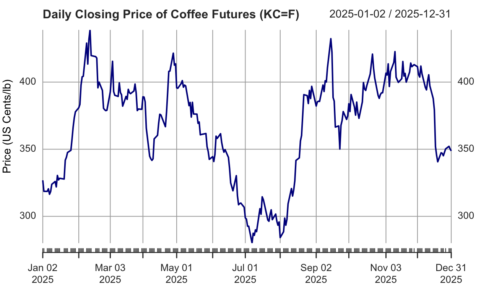
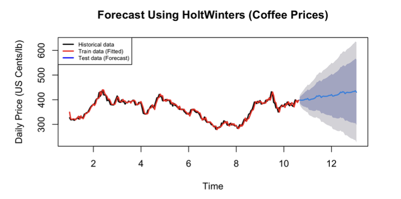
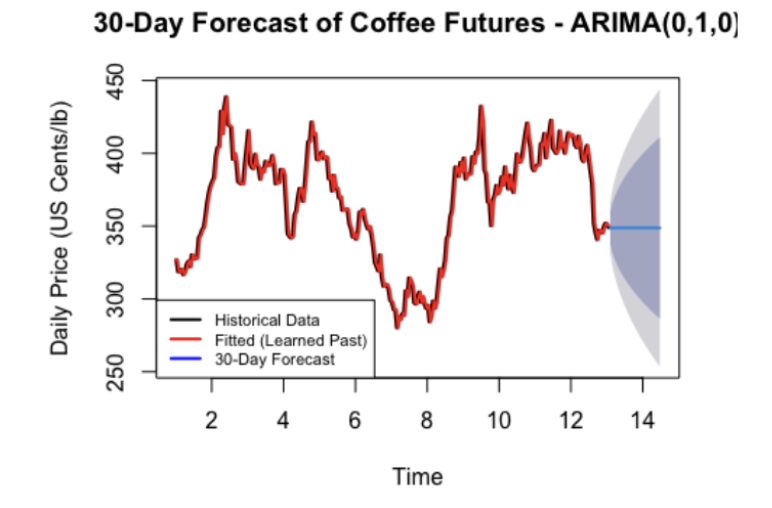

# ☕ Coffee Futures Price Forecasting with R

## 📌 Overview

This project explores daily coffee futures prices using time series analysis and forecasting techniques in R. Using historical data from Yahoo Finance (`KC=F`) for the period from 1 January to 31 December 2025, the analysis investigates price patterns, develops forecasting models, and evaluates their predictive performance.

The project aims to understand historical price movements and identify suitable forecasting approaches for estimating future coffee prices.

## 🎯 Objectives

- Analyze historical coffee futures prices and identify underlying time series components.
- Develop and compare three forecasting models.
- Evaluate forecast accuracy using statistical error measures.
- Examine autocorrelation and stationarity to develop ARIMA/SARIMA models.
- Generate a 30-day forecast using the selected ARIMA/SARIMA model.

## 📊 Data Source

- **Source:** Yahoo Finance
- **Ticker:** `KC=F` (Coffee Futures)
- **Commodity reference:** [Trading Economics — Commodities](https://tradingeconomics.com/commodities)
- **Period:** 1 January – 31 December 2025
- **Frequency:** Daily
- **Observations:** 254 records after removing missing values

The raw dataset is retrieved directly from Yahoo Finance and is not redistributed in this repository.

## 🛠️ Tools & Technologies

- **R & RStudio** — statistical analysis and modelling
- **Time Series Analysis** — trend, seasonality, autocorrelation, and stationarity
- **Forecasting Models** — Holt-Winters, decomposition, regression with dummy variables, and ARIMA/SARIMA
- **Model Evaluation** — forecast error analysis and diagnostic testing

## 📈 Methodology

### 1. Exploratory Time Series Analysis

Visualize historical coffee prices and examine trend, seasonality, and other time series characteristics.

### 2. Forecasting Model Development

Develop and compare three forecasting methods:

- **Additive Holt-Winters Model**
- **Additive Decomposition Model**
- **Regression Model with Dummy Variables**

  
  
  

### 3. Model Evaluation

Split the dataset into training (80%) and testing (20%) subsets. Compare observed and forecast values using forecast error measures such as MAE, RMSE, and MASE.

### 4. ARIMA/SARIMA Analysis

Investigate autocorrelation and stationarity using time series diagnostics and statistical tests. Develop and assess two candidate ARIMA/SARIMA models based on their statistical properties and diagnostic results.

.png)

### 5. Future Price Forecasting

Select an appropriate ARIMA/SARIMA model and generate a 30-day forecast of coffee futures prices.

## 🔍 Key Findings

### Best Forecasting Model: Additive Decomposition

After comparing three models, the **Additive Decomposition Model** was found to perform best in forecasting coffee futures. It achieved the lowest absolute financial deviation with an **RMSE of 24.264322** and the lowest **MASE of 2.7447872**, confirming it as the most robust of the three models for coffee futures forecasting.

Although the MASE of the Additive Decomposition Model is greater than 1 — which theoretically means it performs worse than the naïve model — this is common in a highly volatile commodity market, as evidenced by all three models returning a MASE score greater than 1.

### Selected ARIMA Model: ARIMA(0,1,0)

From the comparison of **ARIMA(0,1,0)** and **ARIMA(0,1,1)**, the **ARIMA(0,1,0)** model was chosen as the best forecasting model for the coffee futures dataset, supported by several criteria:

- The first-difference ACF and PACF plots showed no significant lagged correlations, indicating that `p = 0` and `q = 0` are appropriate.
- The `auto.arima()` function confirmed that ARIMA(0,1,0) is the best model.
- The ARIMA(0,1,1) coefficient proved to be not statistically significant.
- Diagnostic checks confirmed ARIMA(0,1,0) is an adequate model for forecasting coffee futures.

In conclusion, the **ARIMA(0,1,0)** model was used to forecast the next 30 days of coffee futures prices.

## 💡 Key Takeaways

This project demonstrates the application of statistical modelling and time series forecasting to commodity market data. It highlights the importance of exploratory analysis, model comparison, diagnostic testing, and forecast validation when evaluating predictive performance.

## ⚠️ Limitations

The analysis covers one year of daily observations, which may limit the ability to identify longer-term market patterns or reliably estimate recurring annual seasonality. Forecasts are subject to uncertainty and should not be interpreted as investment advice.

## 🗄️ Repository Contents

- `scripts/TSF_Rmarkdown.Rmd` — R Markdown file containing the full time series analysis and forecasting code.
- `scripts/TSF_Rproj.Rproj` — RStudio project file.
- `scripts/TSF_Appendix.pdf` — appendix with supporting output and documentation.
- `images/` — exported charts used in this README (price history, decomposition, models, ACF/PACF, and forecast).
- `README.md` — project documentation.
- `LICENSE` — license terms for this repository.

## 👤 Author

**Chin Mun Qin**

Developed as an academic data analytics project using R for time series analysis, forecasting, and statistical evaluation.
